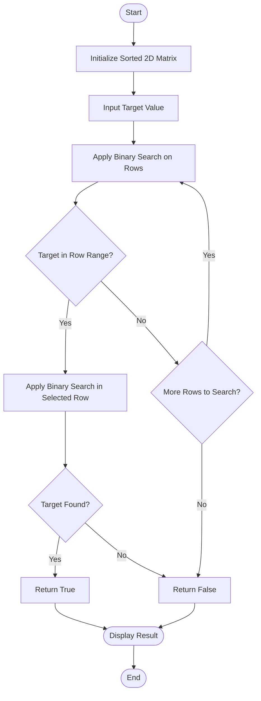

# 🔍 Search a 2D Matrix Using Binary Search

## 📌 Overview

This program searches for a target value in a sorted 2D matrix using **Binary Search**. It first identifies the possible row and then searches within that row efficiently.

## ⚙️ Workflow

1. Start the program and initialize the sorted matrix.
2. Take the target value as input.
3. Apply binary search to identify the possible row.
4. Perform binary search within the selected row.
5. If the target is found, return `true`; otherwise, return `false`.
6. Display the result.

## 📊 Flowchart

## ⏱️ Complexity Analysis

* **Time Complexity:** `O(log m + log n)`
* **Auxiliary Space Complexity:** `O(1)`

Here, `m` represents the number of rows and `n` represents the number of columns.

## 🛠️ Technologies Used

* C++
* Binary Search
* 2D Vectors

## 🎯 Key Learning

This problem demonstrates how to combine two binary searches to efficiently find an element in a sorted 2D matrix.
